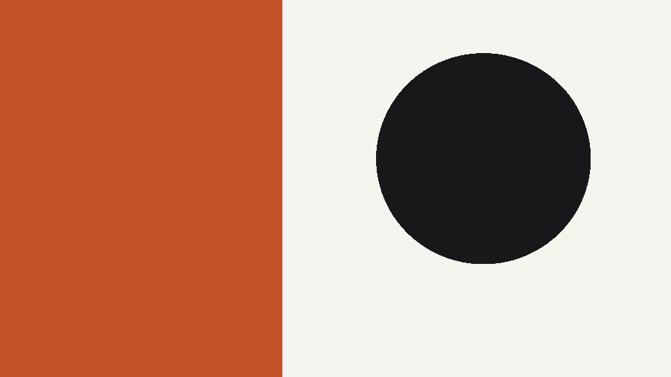
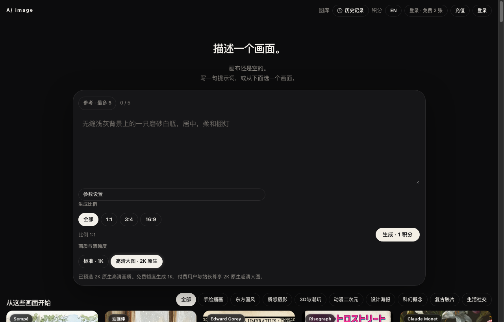

  <b>English</b> | <a href="#chinese"><b>中文说明</b></a>

# AILatest Imagine · Aesthetic Prompt-to-Image Studio 🎨

  <b>Crafting distinctive, high-aesthetic AI illustrations, photography, and concept designs from natural language prompts.</b> 
  支持中英文自由提示词输入，精选 20+ 独家美学艺术预设，支持多参考图垫图与 2K 原生超清导出。

  
  
  
  

---

## 🖼 Visual Showcase

### 1. Official Cover Art

  

### 2. Live Application Interface

  

<em>Live screenshot captured from production: <a href="https://image.ailatest.org/">image.ailatest.org</a>.</em>

---

## 🌟 Key Features

1. **Natural Language Prompting**: Generate art seamlessly from descriptive English or Chinese prompts without needing complex negative syntax boilerplate.
2. **Multi-Image Reference (Image Prompting)**: Upload up to 5 reference images (PNG, JPEG, WebP) to guide character consistency, color grading, or scene composition.
3. **20+ Curated Aesthetic Styles**:
   - **Illustration**: Sempé watercolor, Oil pastel, Edward Gorey gothic ink, Risograph retro print.
   - **Fine Art & Photography**: Claude Monet impressionism, Cinematic 35mm film, Studio product minimalism.
   - **Modern Digital**: 3D clay miniature, Cyberpunk neon, Anime 2D, Graphic editorial poster.
4. **Flexible Aspect Ratios**: One-click switching between `1:1` (square avatar/post), `3:4` (social feed/mobile portrait), and `16:9` (desktop wallpaper/cinematic wide).
5. **Resolution Tiers**: Standard 1K for rapid ideation and Native 2K Ultra-HD for print and production.
6. **Unified AILatest Account**: Shared single sign-on with Journal, RefCheck, and Grant. 2 free image generation credits upon account creation. Automatic quota refunds on failed generations.

---

  <a href="#top"><b>Back to Top (English)</b></a> | <b>中文说明</b>

## 🇨🇳 中文介绍 · AILatest Imagine

### 为什么需要 Imagine？
通用生图工具往往存在提示词门槛高、画面塑料感重、风格千篇一律等问题。Imagine 专注于**艺术质感与实用场景设计**：
- **免复杂垫词**：直接输入自然语言（例如“无缝浅灰背景上的一只磨砂白瓶，居中，柔和棚灯”），即可精准成图。
- **20+ 独家美学预设**：涵盖让-雅克·桑贝（Sempé）水彩插画、复古孔版印刷（Risograph）、爱德华·戈里暗黑钢笔、油画棒质感、杜邦纸黏土、胶片摄影等独特美学风格。
- **支持多图垫图**：最多可上传 5 张参考图片，精确控制画面人物姿态、色调与结构布局。
- **多端与多比例支持**：支持 1:1、3:4（适合小红书/公众号配图）、16:9 比例，支持原生 2K 无水印高分辨率导出。
- **免多余注册**：使用统一 AILatest 账号（与知刊、文献侦探相同），新用户立享 2 张免费体验额度，生成失败自动回退额度。

🌐 **立即在线体验**：[**https://image.ailatest.org/**](https://image.ailatest.org/)
